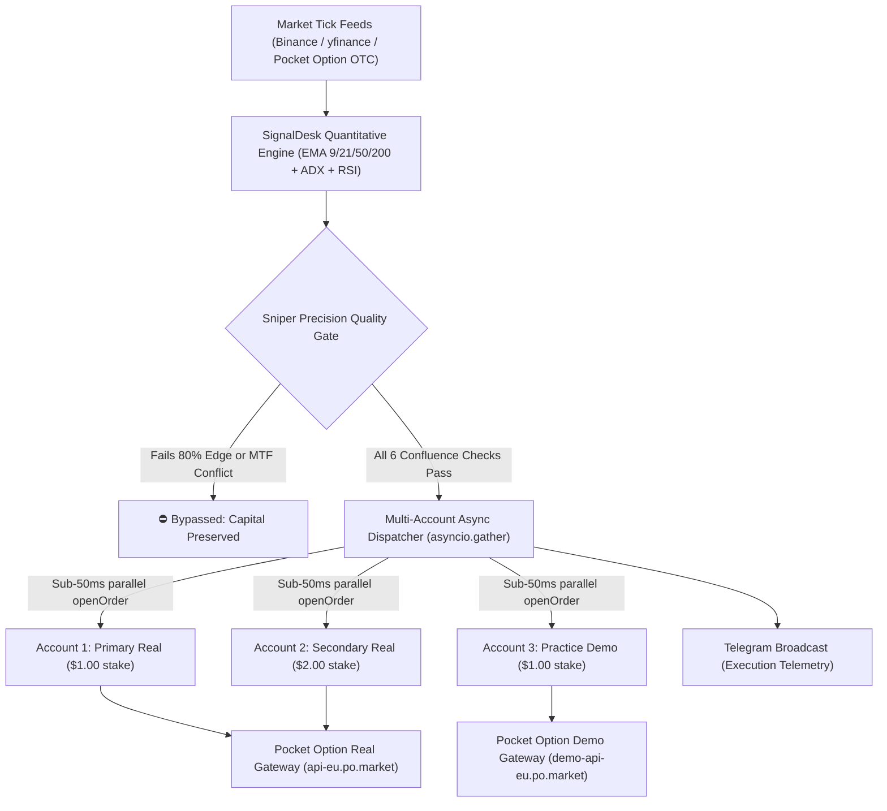

# SignalDesk — Multi-Account Copy-Trading Architecture & User Guide

SignalDesk includes an **Autonomous Multi-Account Copy-Trading Engine**. It allows you to execute quantitative confluence signals across **multiple Pocket Option accounts simultaneously** with sub-50 millisecond parallel dispatch, isolated risk controls, and the 6-Point Sniper Precision Quality Gate.

---

## 📑 Table of Contents
1. [System Architecture](#1-system-architecture)
2. [Core Principles & Features](#2-core-principles--features)
3. [The 6-Point Sniper Precision Quality Gate](#3-the-6-point-sniper-precision-quality-gate)
4. [Step-by-Step: Adding Trading Accounts](#4-step-by-step-adding-trading-accounts)
5. [Managing Accounts from the Dashboard](#5-managing-accounts-from-the-dashboard)
6. [Cloud Deployment & Configuration (Render / VPS)](#6-cloud-deployment--configuration-render--vps)
7. [Telegram Multi-Account Notifications](#7-telegram-multi-account-notifications)
8. [Frequently Asked Questions & Troubleshooting](#8-frequently-asked-questions--troubleshooting)

---

## 1. System Architecture



---

## 2. Core Principles & Features

### ⚡ True Parallel Execution (`asyncio.gather`)
In binary options, entering 1 or 2 seconds late can turn a winning candle into a loss. SignalDesk dispatches orders across all connected accounts in **parallel** rather than sequentially:
- Every account receives the `openOrder` command on the **exact same price tick**.
- Sub-50ms latency ensures identical entry prices across all accounts.

### 🛡️ Independent Risk & Balance Isolation
Each account maintains its own private circuit breaker state:
- **Custom Stake Sizes**: Account 1 can trade at `$1.00`, Account 2 at `$2.50`, and Account 3 at `$5.00`.
- **Isolated Daily Stop-Loss**: If Account 1 hits its daily stop loss (`-$5.00`), **only Account 1 pauses**. Account 2 and Account 3 continue trading uninterrupted if their balances and circuit breakers are healthy.
- **Isolated Take-Profit & Consecutive Loss Limits**: Each account automatically halts when its personal target or consecutive loss threshold is hit.

### 🔄 Mixed Real & Demo Flexibility
You can simultaneously copy-trade to:
- Multiple Real cash accounts.
- A mixture of Real cash accounts and Demo practice accounts.
- Dedicated Demo testing accounts evaluating new indicator settings alongside live cash accounts.

---

## 3. The 6-Point Sniper Precision Quality Gate

Before any order is dispatched to your accounts, it must pass the **Sniper Precision Quality Gate** (`app/signal_engine.py`):

| Check | Requirement | Purpose |
| :--- | :--- | :--- |
| **1. Minimum Confluence** | `Confidence >= 80%` | Filters out weak, marginal 50/50 setups. Telegram may broadcast standard alerts, but Auto-Trade executes only on high-conviction signals. |
| **2. Multi-Timeframe (MTF)** | `1m aligned with 5m` | Verifies that a 1-minute entry does not contradict the 5-minute macro trend (e.g. will NEVER buy against a 5m downtrend). |
| **3. Anti-Exhaustion Guard** | `RSI 32–68 & Bollinger Bounds` | Blocks CALLs when RSI $> 68$ (buying at overbought tops) and blocks PUTs when RSI $< 32$ (selling at oversold bottoms). |
| **4. Candle Body Momentum** | `Close >= Open for BUY`<br>`Close <= Open for SELL` | Ensures the candle is actively moving in the direction of the trade, preventing entry during active opposing price rejection. |
| **5. Rejection Wick Analysis** | `No severe opposing wicks` | Blocks buying when a massive upper wick shows sellers defending resistance; blocks selling when a lower wick shows buyers defending support. |
| **6. Trend Strength (ADX)** | `ADX >= 24.0` | Bypasses flat, low-volume, sideways chop where binary options suffer low win rates. |

---

## 4. Step-by-Step: Adding Trading Accounts

### Step 1: Extract the Account's Signed Session String
For **Real accounts**, Pocket Option requires the full signed PHP cookie string from an authenticated browser session:

1. Open your browser and log into the Pocket Option account you want to connect.
2. Press **`F12`** (or right-click $\rightarrow$ **Inspect**) to open Chrome Developer Tools.
3. Switch to the **Network** tab and click the **WS** (WebSockets) filter.
4. Refresh the Pocket Option trading page (`F5`).
5. Click on the active connection:
   - For Real accounts: `wss://api-eu.po.market/socket.io/?...`
   - For Demo accounts: `wss://demo-api-eu.po.market/socket.io/?...`
6. Click the **Messages** sub-tab and locate the outgoing auth message starting with `42["auth", ...`.
7. Copy the value of the `"session"` property. It will look like this:
   ```text
   a:4:{s:10:"session_id";s:32:"775fd19b5859a5496dc04a9455ff1aa8";s:10:"ip_address";s:13:"41.243.28.132";s:10:"user_agent";s:111:"Mozilla/5.0 (Windows NT 10.0; Win64; x64) AppleWebKit/537.36 (KHTML, like Gecko) Chrome/157.0.0.0 Safari/537.36";s:13:"last_activity";i:1794675308;}8fd505487b34b944e8154de299af4509
   ```
8. Also note your **UID** (e.g., `142203876`), visible in the auth packet or under your Pocket Option profile icon.

---

### Step 2: Register the Account in SignalDesk

1. Open your SignalDesk dashboard:
   - Local: `http://127.0.0.1:8000`
   - Cloud (Render): `https://signaldesk-jv8y.onrender.com`
2. In the top navbar, click the **`👥 Accounts (1)`** button, or open the side drawer and click **`👥 Multi-Account Manager`**.
3. In the modal, click **`➕ Add Trading Account`**.
4. Fill out the account details:
   - **Account Label / Name**: e.g., `Account 2 - Secondary Real`
   - **Pocket Option UID**: e.g., `142203876`
   - **Account Mode**: Select **`REAL LIVE MONEY`** or **`DEMO`**
   - **Stake Amount ($)**: Flat stake per trade (e.g. `$1.00`, `$2.00`)
   - **Signed Session ID**: Paste the full signed session cookie string from Step 1.
   - **Daily Stop Loss ($)**: e.g., `$5.00`
   - **Daily Take Profit ($)**: e.g., `$10.00`
5. Click **`Save Account`**.
6. Click the **`⚡ Test`** button on the new card. SignalDesk will connect to Pocket Option in real-time and return **`✅ Connected`** with `successauth`.

---

## 5. Managing Accounts from the Dashboard

Each registered account card displays live telemetry and individual controls:

```
+------------------------------------------------------------------------+
| 🟢 Main Real Account                   [REAL]     [ACTIVE / MUTED] (o) |
+------------------------------------------------------------------------+
| UID: 142203876 | Stake: $1.00 | Today P&L: +$1.84 | Trades: 2W / 0L   |
| Stop Loss: -$5.00 | Take Profit: +$10.00                               |
+------------------------------------------------------------------------+
| Status: Connected & Live (wss://api-eu.po.market)                      |
| [⚡ Test Connection]       [✏️ Edit Account]       [🗑️ Delete Account]   |
+------------------------------------------------------------------------+
```

### Action Controls
- **`ACTIVE / MUTED` Switch**: Temporarily pause signal copying on this specific account without deleting it or logging out.
- **`⚡ Test Connection`**: Sends an authentication handshake packet to Pocket Option to verify your session cookie is still valid.
- **`✏️ Edit Account`**: Modify the stake size, update stop loss / take profit limits, or refresh session tokens.
- **`🗑️ Delete Account`**: Permanently removes the account from the dispatcher.

---

## 6. Cloud Deployment & Configuration (Render / VPS)

### Option A: Dashboard Management (Recommended)
You can manage, add, and toggle accounts entirely via the SignalDesk web interface. The backend automatically saves changes to `config/accounts.json`.

### Option B: 12-Factor Cloud Environment Variable (`PO_ACCOUNTS`)
On ephemeral platforms where disk storage resets between rebuilds (like free Render or Heroku tiers), you can define all accounts as a single JSON string in your environment variables:

1. Open your **Render Dashboard** $\rightarrow$ Click your **Signal Desk** service $\rightarrow$ Go to **Environment**.
2. Add the variable **`PO_ACCOUNTS`** with your accounts JSON array:
   ```json
   [
     {
       "id": "acc_primary",
       "name": "Main Real Account",
       "uid": 142203876,
       "session_id": "a:4:{s:10:\"session_id\";s:32:\"775fd19b5859a5496dc04a9455ff1aa8\";...}...",
       "is_demo": false,
       "stake_amount": 1.0,
       "max_daily_loss": 5.0,
       "max_daily_profit": 10.0,
       "max_consecutive_losses": 3,
       "enabled": true
     },
     {
       "id": "acc_secondary",
       "name": "Account 2 (Real)",
       "uid": 987654321,
       "session_id": "a:4:{s:10:\"session_id\";s:32:\"...\";...}...",
       "is_demo": false,
       "stake_amount": 2.0,
       "max_daily_loss": 10.0,
       "max_daily_profit": 20.0,
       "max_consecutive_losses": 3,
       "enabled": true
     }
   ]
   ```
3. Save changes. SignalDesk will load and authenticate all accounts on startup.

---

## 7. Telegram Multi-Account Notifications

Whenever a trade passes the Sniper Quality Gate, Telegram sends an automated notification detailing execution across all active accounts:

### Successful Multi-Account Execution:
```text
🎯 SNIPER AUTO-EXECUTED on 2 Account(s) (86% Confidence):
• Main Real Account: $1.00
• Account 2 (Real): $2.00
Duration: 1m Duration
Optimal Zone: 1.05420 - 1.05435
Confluence: ADX 28.5 + Strong Bullish MA Stack + MTF 5m Confirmed
```

### Partial Execution / Circuit Breaker Notification:
If an account is protected by a circuit breaker (e.g. daily stop-loss hit), it will be safely bypassed while others execute:
```text
🎯 SNIPER AUTO-EXECUTED on 1 Account(s) (84% Confidence):
• Account 2 (Real): $2.00
⚠️ Main Real Account: SKIPPED (Daily stop-loss limit -$5.00 reached)
```

---

## 8. Frequently Asked Questions & Troubleshooting

### Q1: What does `42["NotAuthorized"]` mean?
Pocket Option rejected the session cookie. This happens if:
1. You only pasted the 32-character `session_id` hash instead of the **full signed string** (`a:4:{s:10:...}...`).
2. The browser session was logged out or expired.
**Fix**: Re-inspect your browser's Network $\rightarrow$ WS tab, copy the full signed session string, and update the account in SignalDesk.

### Q2: Why did Telegram send a signal, but no auto-trade executed?
SignalDesk operates with dual standards:
- **Telegram Alerts**: Sent for general market setups (70%+ confidence).
- **Auto-Trade Execution**: Requires the **Sniper Precision Quality Gate** (80%+ confidence, 1m+5m MTF alignment, green/red candle momentum confirmation, and no wick rejections).
If any of these 6 filters fail, the trade is intentionally skipped to preserve your capital.

### Q3: What is the Pacing Cooldown?
SignalDesk enforces a mandatory **30-second delay** between trades on each account. This prevents accidental multi-trade cluster spikes during rapid market movements on the same candle.

### Q4: Can I run 1 Real account and 1 Demo account at the same time?
**Yes.** Set Account 1's mode to `REAL` and Account 2's mode to `DEMO`. SignalDesk will route Account 1 to `api-eu.po.market` and Account 2 to `demo-api-eu.po.market` simultaneously.
